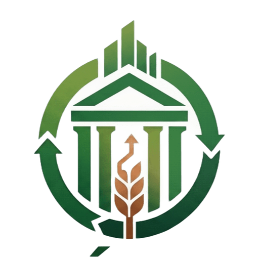

<div align="center">



# Ecópolis

**Sustentabilidade urbana com coleta seletiva e recompensas no Gama (DF)**

</div>

---

## Apresentação

O **Ecópolis** é uma plataforma web responsiva de incentivo à coleta seletiva voltada à Região Administrativa do Gama, no Distrito Federal. A proposta é aproximar cidadãos, pontos de coleta e gestão pública em um único ambiente, transformando o descarte correto de resíduos em uma experiência simples, acompanhável e recompensada.

Cada descarte validado gera **Ecopontos**, a moeda virtual da plataforma, que podem ser trocados por benefícios oferecidos por empresas, feiras, bazares e organizações parceiras da comunidade.

## O problema

Grande parte dos resíduos recicláveis ainda é descartada de forma inadequada. Entre os motivos mais comuns estão a falta de informação sobre onde descartar, a ausência de retorno percebido pelo cidadão e a dificuldade da gestão pública em acompanhar o volume efetivamente coletado.

## A proposta

O Ecópolis atua em três frentes:

1. **Informação:** mapa das ecolocalizações (pontos de coleta) do Gama, com endereço, horário de atendimento e materiais aceitos.
2. **Incentivo:** sistema de Ecopontos, níveis, ranking e conquistas que reconhece a participação de cada cidadão.
3. **Gestão:** painel para administrar valores por material, recompensas, parceiros, equipe e novos pontos de coleta, com indicadores reais do programa.

## Perfis de acesso

### Cidadão
- Cadastro e acesso com e-mail e senha, recuperação de senha por e-mail e edição de perfil com foto.
- Mapa de ecolocalizações com busca, distância a partir da localização atual e rota até o ponto.
- **Registro de descarte:** o cidadão declara o material e o peso estimado e recebe um código de entrega de quatro dígitos.
- **Coleta domiciliar:** agendamento por dia e faixa de horário, com endereço preenchido a partir do CEP, acompanhamento e cancelamento.
- Loja de recompensas, ranking (semana, mês e geral), conquistas, histórico de atividades e central de notificações.
- Sugestão de novos pontos de coleta, que passam pela análise da gestão antes de aparecer no mapa.

### Operador de ecolocalização
- **Recebimento de entregas:** confere o código apresentado pelo cidadão, o material e o peso real na balança.
- Confirma, ajusta (quando material ou peso diferem do declarado) ou recusa a entrega, com o motivo.
- Executa as coletas domiciliares agendadas e registra o material e o peso coletados.

### Gestor
- Painel com indicadores do mês: cidadãos cadastrados, quilos coletados, Ecopontos emitidos e resgates.
- Definição do valor em Ecopontos por quilo de cada material.
- Gestão de recompensas (custo, estoque e visibilidade) e de parceiros.
- Análise das sugestões de novos pontos, com confirmação da posição no mapa.
- Gestão da equipe por convite: o acesso de gestor e operador não é obtido pelo cadastro público.

## Regras de funcionamento

- **Validação presencial:** os Ecopontos de um descarte só são creditados depois da conferência do operador na ecolocalização. O valor é calculado pela taxa do material multiplicada pelo peso efetivamente conferido. Diferenças de até 10% no peso confirmam a entrega; acima disso, ela é ajustada.
- **Código de uso único:** cada código de entrega fica visível apenas para o cidadão e não pode ser usado duas vezes.
- **Níveis:** definidos pelo total de Ecopontos já conquistados (Semente Verde, Broto Verde, Guardião Verde, Árvore Viva e Floresta Urbana). Resgates reduzem o saldo, mas não o nível.
- **Coleta domiciliar:** de segunda a sábado, em quatro faixas de horário, com cancelamento permitido até o início da faixa agendada.
- **Separação de responsabilidades:** somente o gestor altera valores, recompensas, parceiros e equipe; o operador apenas valida entregas e coletas; o cidadão não acessa funções administrativas.

## Arquitetura

| Camada | Tecnologias |
| --- | --- |
| Interface | React 19, TypeScript, Vite e Tailwind CSS |
| Autenticação | Supabase Auth |
| Regras de negócio | Supabase Edge Functions (Deno + Hono) |
| Dados | Banco PostgreSQL do Supabase |
| Arquivos | Supabase Storage (fotos de perfil em bucket privado, entregues por link assinado) |
| Mapas | Mapbox GL JS e Mapbox Geocoding |
| Endereços | API ViaCEP |
| Hospedagem | Vercel |

Toda regra sensível (crédito de Ecopontos, baixa de estoque, validação de códigos e convites e permissões de cada perfil) é executada no servidor. A interface apenas exibe e solicita operações.

## Segurança e privacidade

- A chave administrativa do Supabase existe apenas no servidor. O navegador usa somente a chave pública.
- A tabela de dados não pode ser lida nem alterada diretamente pelo navegador; o acesso passa pelas regras do servidor.
- As fotos de perfil ficam em armazenamento privado e são exibidas por links temporários.
- Por tratar dados pessoais (nome, e-mail, telefone e endereço), a operação em larga escala deve seguir a Lei Geral de Proteção de Dados (LGPD), com termos de uso e política de privacidade publicados.

## Estrutura do repositório

```
src/
  screens/      Telas da aplicação (cidadão, operador e gestor)
  components/   Componentes reutilizáveis (navegação, mapa, avatar, ícones)
  data/         Tipos, catálogo e regras de exibição
  lib/          Integração com Supabase e Mapbox
supabase/
  functions/server/   Servidor com as regras de negócio
public/         Ícones do site
```

## Como executar

Pré-requisitos: Node.js 22 e pnpm.

```bash
pnpm install
VITE_MAPBOX_TOKEN=pk.seu_token pnpm dev
```

Sem `VITE_MAPBOX_TOKEN`, a aplicação exibe um mapa ilustrado no lugar do mapa interativo.

## Implantação

1. Importe o repositório na Vercel (as configurações de build estão em `vercel.json`).
2. Cadastre a variável de ambiente `VITE_MAPBOX_TOKEN`.
3. No Supabase, em *Authentication → URL Configuration*, informe o domínio publicado em **Site URL** e **Redirect URLs**.

No primeiro acesso, a aba **Gestor** da tela de login oferece a configuração do primeiro gestor. Depois disso, novos membros da equipe entram somente por convite.

## Próximos passos

- Integração com balanças digitais nas ecolocalizações.
- Relatórios exportáveis para a gestão pública.
- Aplicativo móvel com notificações push.
- Expansão para outras regiões administrativas do Distrito Federal.

---

<div align="center">
Ecópolis · Gama, Distrito Federal
</div>
